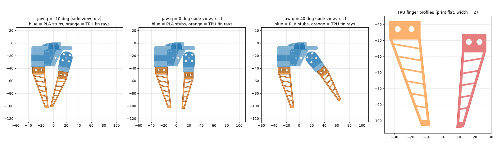

# Fin-ray gripper for the SO-101 follower

TPU fin-ray fingers that wrap a cherry tomato instead of pinching it. The fingers bolt into
PLA stubs: the two stock jaw parts with their fingers cut off and a clamp (clevis) added.
Everything above the cut is the unchanged stock part, so the servo, horn and wrist fit as before.



**Watch it first:** `python view_gripper.py --stock` opens a 3D window with a jaw-angle slider and
the stock fingers ghosted for comparison.

## What to print

| File (`out/`) | Material | Qty | Notes |
|---|---|---|---|
| `stub_wrist_roll_follower_PLA.stl` | PLA+ / PETG | 1 | replaces `Wrist_Roll_Follower_SO101` (fixed jaw + servo housing) |
| `stub_moving_jaw_PLA.stl` | PLA+ / PETG | 1 | replaces `Moving_Jaw_SO101` |
| `finger_fixed_TPU.stl` | TPU 95A | 1 | lies flat, no supports |
| `finger_moving_TPU.stl` | TPU 95A | 1 | lies flat, no supports |

Sliced in Bambu Studio 2.8 (A1 profile, 0.2 mm, 4 walls, 40 % infill):

| Plate | Weight | Time |
|---|---|---|
| PLA stubs, tree supports | 54 g | 2 h 37 m |
| TPU fingers, no supports | 17 g | 1 h 22 m |

- The two stubs need supports, like the stock parts. The moving stub prints on its side and its
  clamp cheeks overhang.
- TPU and PLA can't share a plate (TPU doesn't go through the AMS), so that's 2 plates.
- The TPU flanks are 1.6 mm = 4 perimeters. Keep 4 walls so they print as solid walls with no infill.

## Hardware

- 4 × M3 × 25 socket head screws + 4 × M3 nuts. The nuts go into the hex traps on the −y cheek.
- The stock screws for the horn and the wrist.

## Fitting

1. ⚠️ **Leave the horn on the gripper servo.** Unscrew the jaw from the horn; don't pull the horn
   off its spline. The fingers keep the stock outline, so the `follower_white` gripper calibration
   only stays valid if the horn doesn't move.
2. Swap `Wrist_Roll_Follower_SO101` for the PLA stub: same servo pocket, same wrist interface.
   Swap `Moving_Jaw_SO101` for its PLA stub, on the same horn screws.
3. Push each TPU finger's base block into its clamp, all the way to the stub, with the
   **contact flank** facing the other finger (thin straight side; the ribs slope up toward the
   back flank). Bolt it through both cheeks. Tighten until the block stops moving and no further:
   TPU creeps.
4. Close the gripper by hand with torque off. At the closed stop the TPU tips should be about
   3 mm apart (stock: about 1 mm).
5. Then fill in the acceptance list in [`../README.md`](../README.md).

## Design

- **Outline:** each finger is the stock finger's side outline, traced from sections every 5 mm.
  It has a straight contact flank and a straight back flank meeting at a solid 4 mm tip, joined
  by 5–6 ribs. Pressing the contact flank bends the tip *toward* the fruit: that's the fin-ray
  effect.
- **Width:** 18 mm constant. The stock finger tapers from 28 mm to 9 mm.
- **Clamp:** a 10 mm deep base block, clamped between two 3 mm cheeks by two cross bolts, so both
  flanks are held rigidly. A fin ray stops working if its base can rock.
- **Grip range:** the gap between the contact flanks at mid-finger is 12 mm at the closed stop
  (−10°), 22 mm at 0°, 31 mm at 10° and 40 mm at 20°. A 20–30 mm cherry tomato touches at about
  0°–10°, and closing further wraps it.
- **Checks run by `finray_gripper.py check`:**
  - every part is watertight and a single solid body
  - the stubs keep all stock material above the cut (0.000 mm³ lost)
  - nothing new touches the gripper servo
  - the moving finger and its clamp never hit the fixed jaw over the full −10°…100° range
- **Not checked yet:**
  - grip force
  - TPU fatigue at the base
  - whether the rib angle and pitch wrap a tomato well. Those are guesses marked `unverified`
    in the code. Test on fruit first.

## Rebuild

```bash
pip install numpy shapely trimesh manifold3d matplotlib   # a throwaway venv works
python finray_gripper.py check    # checks + preview.png
python finray_gripper.py build    # checks, then out/*.stl
python view_gripper.py --stock    # window with jaw slider
```

Parameters are at the top of `finray_gripper.py`. Each one has a comment saying where its value
came from.

## Stock parts and licence

`stock/` contains these files from [TheRobotStudio/SO-ARM100](https://github.com/TheRobotStudio/SO-ARM100)
at commit `a758567` (Apache-2.0):

- `STL/SO101/Individual/Moving_Jaw_SO101.stl`
- `STL/SO101/Individual/Wrist_Roll_Follower_SO101.stl`
- `Simulation/SO101/assets/sts3215_03a_v1.stl`, used for the collision check only

The assembly transforms are the URDF origins from `Simulation/SO101/so101_new_calib.urdf`. The
print STLs sit exactly in those URDF mesh frames: ICP onto the URDF meshes gave 0.01 mm RMS.

The two `*_PLA.stl` stubs are **modified** versions of the stock parts: the finger was removed
below the cut and a clevis was added. The upstream repo also has a TPU "Compliant Gripper"
(`Optional/Compliant_Gripper`). That one reprints the whole jaw, including the servo housing, in
TPU. This design keeps the servo housing rigid and makes only the fingers soft.
