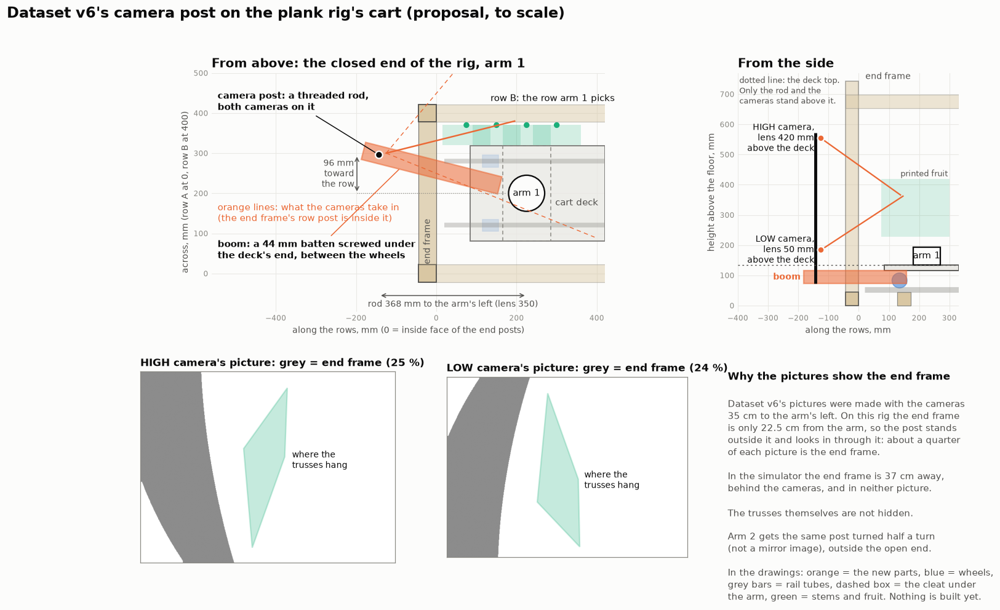

# Pipe-rail test rig (wooden, knock-down)

A portable demo and sim2real rig for two SO-101s. It has two vine rows of 3D-printed trusses on dowel stems and a two-tube pipe rail in the aisle. One cart rolls on the rail and carries both arms. It replaces the laser-cut house (`../lasercut/`, too expensive) and the printed one (`..`).

- **Size:** 0.99 x 0.44 x 0.76 m. The rail runs out to 1.2 m.
- **Takes apart:** the two row frames are screwed; the three cross ties come off with M6 wing nuts.
- **Parts:** only Gamma parts, about €112. See [`SHOPPING_LIST_GAMMA.md`](SHOPPING_LIST_GAMMA.md) for links, prices on 2026-11-19 and the cut list.
- **Onshape:** private doc "Vinea Pipe-Rail Test Rig",
  <https://cad.onshape.com/documents/366548c7ac101223d75c80f7/w/c597d55c8aa54a7960789577/e/107341004be3c9f5c68afa06>.
  - Part Studio 1 holds the "Pipe-Rail Test Rig" feature: the rig, part codes on the wood, and the CUT PLAN beside it.
  - The second feature, "SO-101 arms on the cart", places the imported arm meshes.

## What stays the same as the sim

These come from `sim/scene.py` and `sim/truss_scene.py`:
- The arm base sits mid-aisle, 200 mm from each row.
- The stems hang from string rails 520 mm above the arm base.
- Trusses hang 140-320 mm above the arm base.
- The birdseye camera stands 150 mm behind the row the arm doesn't face, 340 mm above the arm base.

## What differs from the sim

These are design choices, not yet checked for sim2real:
- The posts stand on the row lines. In the sim, the end frames are 370 mm from the arm; here they're about 225 mm.
- The two arms are 450 mm apart and face opposite rows.
- There is no riser.
- The stems sit 30 mm off the row line.
- ⚠️ With the end frames 225 mm from the arm, dataset v6's camera post stands outside them and looks in through
  them (see "Camera post for dataset v6").
- ⚠️ No crate is drawn on the cart. In the dataset the crate lies 13 to 36 cm to the arm's right, which here is
  between the two arms: placed like that, the two arms' crates overlap by 185 mm along the cart, and each reaches
  51 mm past the deck's edge (`cart_camera_post.py` prints the numbers).

## Camera post for dataset v6 (rig `trio`): a proposal, not built

Dataset v6's pictures come from two fixed cameras on one post that travels with the arm (`sim/scene.py` `CART_CAMS`),
plus the claw camera. Where the lenses are is set by that dataset, so on the real cart it is not a choice. How the
post is carried is a proposal of 2026-11-27 that fits the cart as `pipe_rail_rig.fs` v3 draws it.
⚠️ It is not in the Onshape model or the cut plan, and nothing is built.



**Where the lenses must be** (from the arm base: left and right along the row, toward the row the arm faces, up from
the deck top):

| Camera | To the arm's left | Toward the row | Above the deck top | Turned toward the row | Tilted |
|---|---|---|---|---|---|
| high (gives the cue numbers) | 350 mm | 100 mm | 420 mm | 14.0° from the aisle line | 34.7° down |
| low | 350 mm | 100 mm | 50 mm | 12.3° | 32.7° up |

By ruler from the pan axis (the upright axis the whole arm turns about): 350 mm to the left, 61 mm toward the row.
The simulator's post is a 16 mm rod standing 18 mm behind the lenses. In dataset v5's 800 recorded episodes the arm
came no nearer than 44 mm to the line under the lens and a carried truss no nearer than 17 mm; with that rod and the
camera housings in the model, nothing touched them in the 32 episodes that came within 6 cm
(`own_sim_measurements.md` section 26). So the real upright must not be thicker than 16 mm or stand nearer the arm.

**On this rig** that puts the rod at x −143, y 296 for arm 1 (the lenses at x −125, y 300, z 184 and 554): 143 mm
outside the closed end frame's inside face. Arm 2 is arm 1 turned half a turn, so its post is the same assembly
turned half a turn about the middle of the house: x 1043, y 104, outside the open end.
⚠️ Not a mirror image: a mirrored post would stand on arm 2's right and its pictures would be flipped.

**How it is carried:**
- **Boom**: one more 350 mm length of the 44 x 44 batten per arm, screwed under the deck's end with its top against
  the deck's underside. It lies between the wheel brackets, turned 14° from the aisle line, and reaches 267 mm past
  the deck's end. Three screws from above through deck strip D-2, heads flush, shorter than the 62 mm stack.
  ⚠️ Only 75 mm of it lies under the deck, because the cleat under the arm is in the way: the three screws sit
  close together, and a knock on the rod levers on them. Notching the boom over the cleat would give it more hold.
- **Upright**: an M12 threaded rod, 500 mm (one 1 m rod cut in half does both arms), through the boom's outer end.
  One nut and washer on top of the boom, one sunk into its underside so nothing hangs below it.
- **Cameras**: each on a clamp between two nuts, so the height is set by turning nuts. No clamp is drawn yet; a
  printed one takes a 12.6 mm hole (0.3 mm per side).
- ⚠️ Everything except the rod and the two cameras stays at or below the deck top (the simulator's table is at
  that height, so nothing in the dataset ever goes below it). Above it the arm swings out to that side: every
  camera spot nearer the arm was in its way in the recorded episodes.
- With both posts on, the cart sticks out about 14 cm past each end of the house; the booms unscrew for transport.
- If the two birdseye masts are left out (dataset v6 does not use that camera), their poles B4-5 and B4-6 are long
  enough for the two booms. Check first whether another module still needs the birdseye camera.

**Clearances** (`cart_camera_post.py` computes them from the `.fs` dimensions and stops if one is short):

| Between | mm |
|---|---|
| boom and the wheel bracket / the wheel's axle bolt | 12 / 13 |
| boom's inner end and cleat D-3 (the arm bolts through that cleat) | 2 |
| boom's underside and the rail tubes / the sleepers and floor tie | 9 / 28 |
| boom and rod passing the end frame's row post when the cart rolls | 51 / 71 |
| rod and the stems / the printed fruit of the row it rolls past | 64 / 18 |
| high camera over the highest printed fruit / low camera under the lowest | 124 / 33 |
| high camera under the end frame's top tie | 109 |

**⚠️ What the cameras see here that the dataset does not have.** In the simulator the end frame stands 370 mm from
the arm, behind the cameras. Here it stands 225 mm away, so the post is outside it and looks in through it: the end
frame's row post fills about a quarter of each fixed camera's picture (25 % of high, 24 % of low, the left side).
The place where the trusses hang is not hidden. Three ways to deal with it, K7's call:
1. **Build as drawn** and see whether the policy minds.
2. **A longer house**: end frames at least 370 mm from each arm ("Inside length" 1200 mm instead of 900 in the
   Onshape feature). The post then stands just inside the end frame, as in the simulator. The rails grow from 988 to
   1288 mm, which no longer fit the cut plan's battens 1 and 2 beside a post, so it takes at least one more batten
   and a new cut plan; the rig becomes 1.29 m long.
3. **Put this rig's end frame in the simulator** and re-make the dataset's pictures from the saved states
   (`sim/remake_pictures.py`), then train on those. The rig's layout is not in the simulator yet.

**Not checked:**
- ⚠️ Whether the arm's recorded motions stay clear of this rig's end posts at all. They stand 145 mm nearer the
  arm than the simulator's end frame: the nearest corner of the row post is 75 mm to the arm's left of where the
  leftmost stem hangs. `sim/whatif/camera_sweep_logs.py arm --cams 0.145:0.378:0.52` (and `plants`) measures it
  against all recorded episodes; not run yet, it waits for the dataset run to end. If the arm or a carried truss
  passes through there, the longer house (way 2) is needed whatever the pictures show.
- How much the cameras shake. A beam-formula estimate gives a first sway near 22 Hz for the M12 rod on this boom; an
  M16 rod barely changes it, because the boom's twist then sets the limit. Tap the post and watch the picture.
- The lens model is the simulator's guess for this camera module, not a calibration.

```bash
cd hardware/greenhouse/pipe_rail_rig && python cart_camera_post.py renders/cart_camera_post.png   # env lerobot-mj4
```

## Files

| File | What |
|---|---|
| `pipe_rail_rig.fs` | The rig as a FeatureScript feature. It takes 5 dimensions plus 2 switches, "Show cut plan" and "Emboss part codes". Every part is named `code \| what \| cut length \| [item] Gamma product`. |
| `so101_arms.fs` | Template that places the arm meshes. The `__E_*__` / `__MV__` placeholders are filled with the doc's element ids and microversion at upload. |
| `pose_so101_stl.py` | Writes the posed SO-101 meshes (`so101_<reach\|start>_<a\|b>.stl`) from the sim's MJCF. |
| `so101_*.stl` | Those meshes, in metres in the arm base frame. Each is split into two halves to stay under a 10 MB upload limit. |
| `SHOPPING_LIST_GAMMA.md` | Gamma links, quantities, the cut list with marks, and the wheel options. |
| `renders/` | Onshape shaded views of the rig, a joint close-up and the cut plan. |
| `cart_camera_post.py` | Checks and draws dataset v6's camera post on the cart (`renders/cart_camera_post.png`). |

## Rebuilding the arm meshes

Run this from `sim/`. It needs `fast_simplification`; `pip install --target <dir>` works.

```bash
PYTHONPATH=<dir> python ../hardware/greenhouse/pipe_rail_rig/pose_so101_stl.py ../hardware/greenhouse/pipe_rail_rig
```

⚠️ Onshape assemblies skip mesh pieces that import as open surfaces. That's why `so101_arms.fs` instantiates the imported Part Studios inside the rig's Part Studio instead of using an assembly.

⚠️ With the part codes and the cut plan switched on, the rig takes about 1.5 min to rebuild in Onshape.

## Not done yet

- Printed parts: the truss and clip STLs, and the U-groove wheel and bracket.
- Nothing has been built or tested on hardware.
- Dataset v6's camera post (boom, rod, camera clamps): proposed above, not in the Onshape model or the cut plan.
- The sim has not been updated to this layout. It still has 3 rows, 1 arm, no rail, and end frames 370 mm from the arm.
